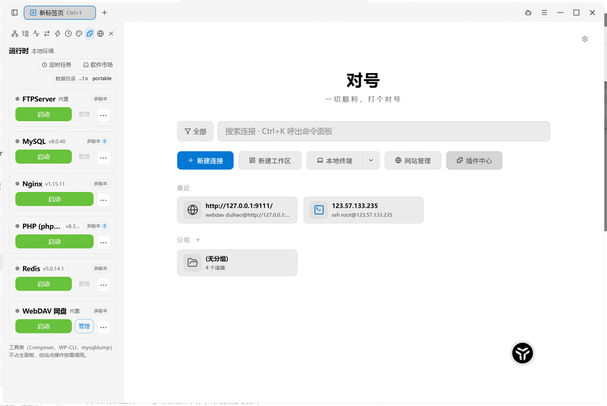
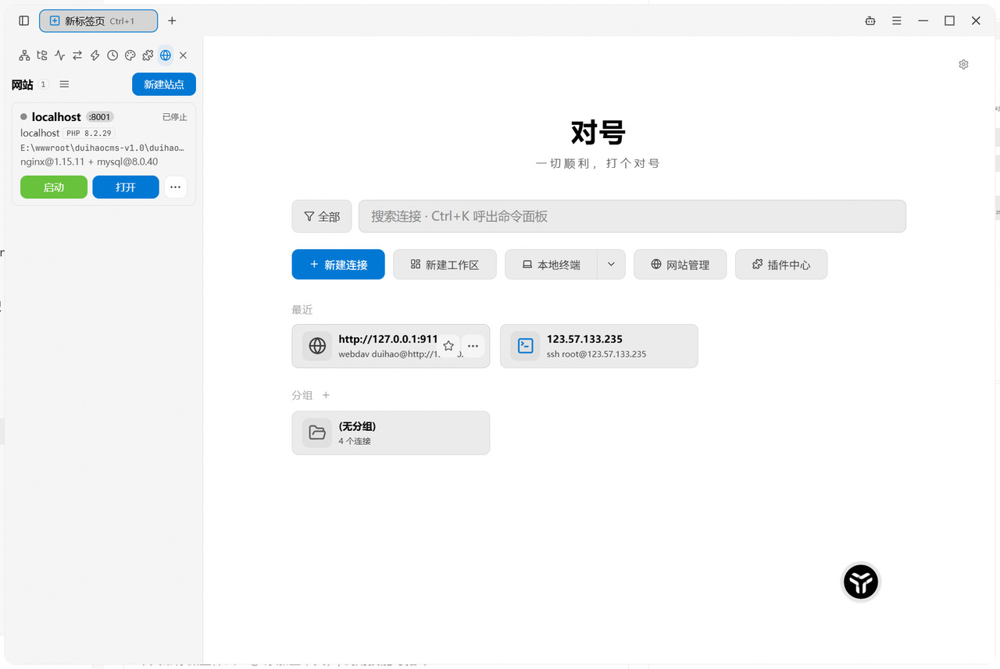
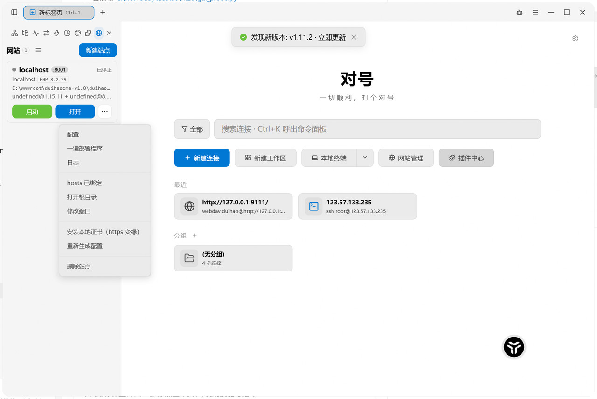
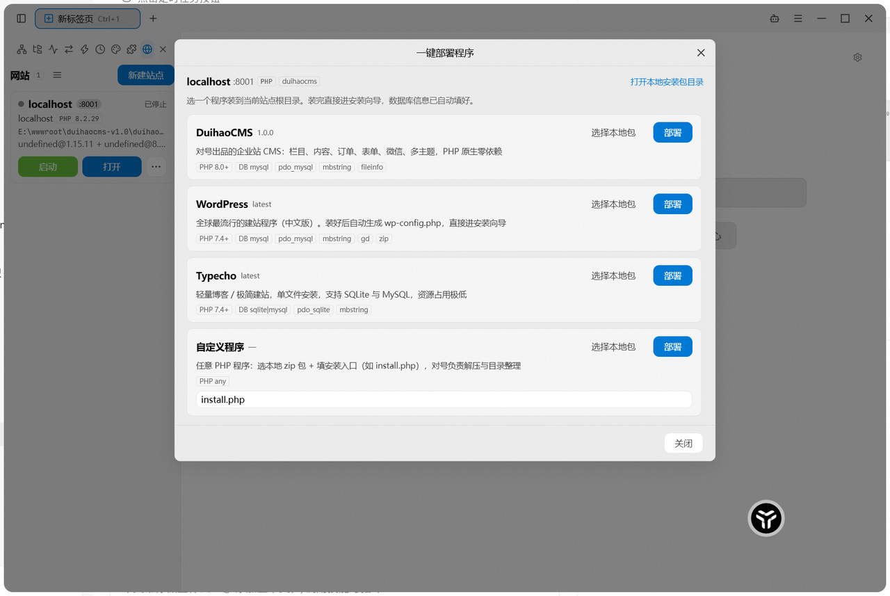
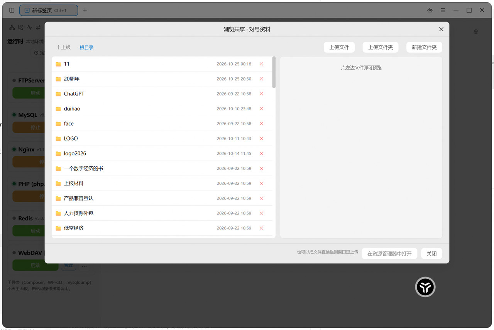
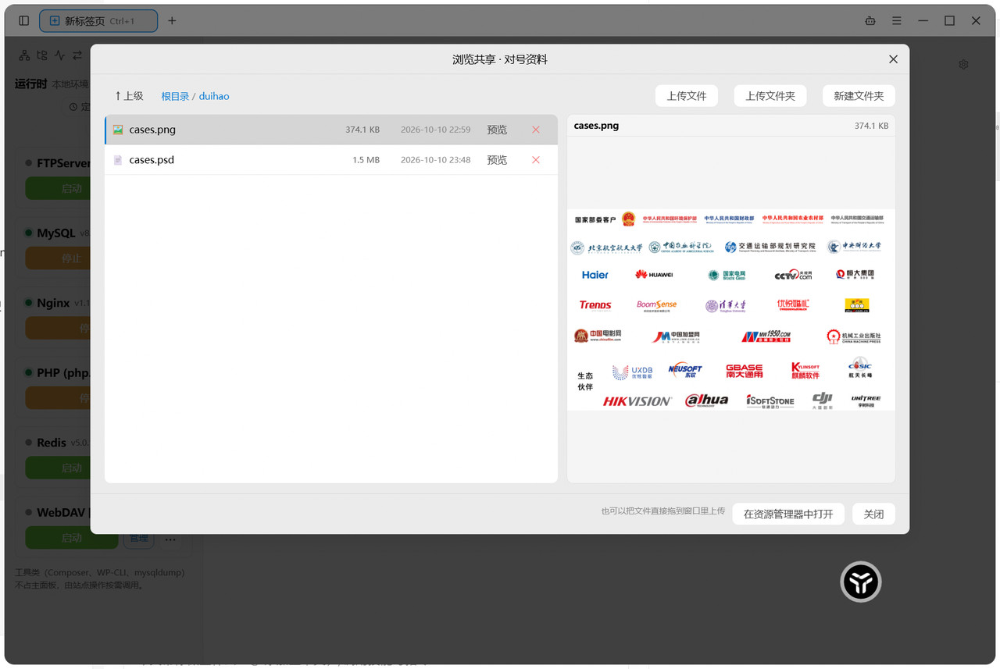
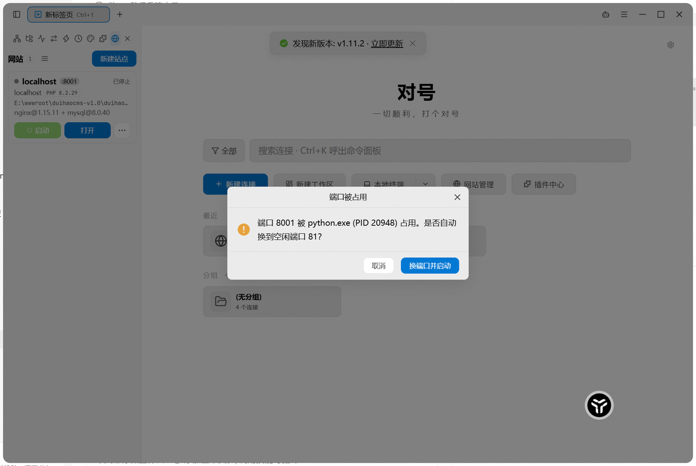

<div align="center">
  
  <h1>对号 DUIHAO</h1>
  <p><b>对号 · 本地能力唤醒台</b><br>Alt+Space 唤醒你机器上的站点、环境、终端与文件</p>
</div>

<div align="center">

简体中文 &nbsp;|&nbsp; <a href="docs/screenshots/00-home.jpg">界面截图</a>

<a href="LICENSE"></a>


</div>



## 这是什么

「对号」是一个 **Windows 本地能力唤醒台**：常驻后台，`Alt+Space` 一键唤醒，用完即走。

它把 phpStudy 那套本地环境做成了现代化形态，同时把能力都收在自己手里——**唤醒的是你自己机器上的能力，出厂即可用**：

- 唤醒 **环境**：nginx + 多版本 PHP + MySQL + Redis，卡片点「启动」，多版本可同时运行。
- 唤醒 **站点**：域名 + PHP 版本 + 一键部署程序，几分钟出站，HTTPS 也已签好。
- 唤醒 **文件**：内置 WebDAV 网盘，可视化浏览、预览、上传。
- 唤醒 **终端**：30+ 协议的终端引擎，连接、传文件、数据库、容器、监控一站直达。

所有能力都在本机执行：**断网可用，数据不出机器**。

## 功能

### 1. 唤醒台：一个热键，进入所有能力

- `Alt+Space` 全局呼出、`Ctrl+K` 主窗口呼出：屏幕顶部居中的悬浮面板窗（640×480），搜连接、搜动作、跳视图，回车即执行。
- 桌面悬浮球（48px 可拖拽，`/?w=float`）常驻；主窗口默认后台隐藏，由面板动作、托盘或 `Ctrl+M` 唤起。
- 面板负责**快**（启停、搜索、连接、部署、跳转），主窗口负责**全**（复杂表单、管理台、批量操作），两者共享同一套动作通道与审计。

### 2. 环境：一张卡片管一个软件


左侧「环境」区每个软件一张卡片：状态灯 · 名称 · 版本 · 多版本胶囊 · 启动/停止 · 管理 · 更多。

| 软件 | 说明 |
| --- | --- |
| nginx | 站点统一入口，按站点生成配置片段并热重载 |
| PHP | 多版本并存（如 8.2 / 8.3 / 8.4），内置 **35 个扩展开关** |
| MySQL | 库/账号管理、root 改密、备份 |
| Redis | key 浏览、命令台、内存信息 |
| FTP Server | 内置服务，多账号（密码 bcrypt 存储） |
| WebDAV 网盘 | 内置服务，共享目录 + 只读共享 + 可视化浏览 |

- 插件按 **声明式清单**（`plugin-manifest` v2）描述：依赖、端口角色、设置项、可执行动作。加一个软件 = 加一份 JSON。
- 设置项按清单渲染成 Tab（PHP 就是「扩展·常用 / 扩展·数据与网络 / 扩展·文档与系统 / 性能与限制 / 配置文件」）。
- 支持 **多版本**：同一软件装多份互不干扰，各自端口与数据目录。

### 3. 站点管理：一个站点 = 域名 + PHP 版本 + 根目录



- **同端口虚拟主机**：nginx 主配置 include `sites/*.conf`，站点只编排不启进程。
- **站点绑 PHP 版本**（phpStudy 模式）：站点里直接选 PHP 版本，启动站点才拉起对应 php-cgi；不同版本可同时跑。选未安装的版本，保存时自动装配运行时。
- **HTTPS 开箱可用**：本地根 CA（ECDSA P-256，20 年）签发站点证书（825 天）；一键把根证书装进当前用户证书存储（免 UAC），浏览器不再报警。
- **创建环境**：FTP 账号 / 建库 / hosts 绑定，勾一下全办好，失败只警告不废站点（比如 hosts 需要管理员权限）。



每个站点九个动作：配置 / 一键部署程序 / 日志 / hosts 已绑定 / 打开根目录 / 修改端口 / 安装本地证书 / 重新生成配置 / 删除站点。

### 4. 一键部署：选程序 → 装好 → 数据库已填好



内置声明式程序模板（`apps.json`，编译进本体，加程序只加 JSON）：

| 程序 | 说明 |
| --- | --- |
| **DuihaoCMS** | 优先推荐，安装向导会自动填好库名/账号/密码 |
| WordPress | 自动生成 `wp-config.php`（含 8 个盐值） |
| Typecho | 官方 release 包 |
| 自定义 | 指定本地 zip + 入口文件 |

- 三级取包：本地包 → 内置包 → 下载（逐包 SHA256 校验）。
- 解压自动剥离单层顶层目录（避免站点根变成 `/wordpress/index.php` 而 404）。
- **只覆盖同名文件，绝不删你的文件**；根目录非空会先确认。
- 老版本安装包不认识预填文件时，删除预填文件（不留库密码）并给出可复制的连接串。

### 5. 本地网盘：可视化 WebDAV



- 目录在前、大小写不敏感排序；面包屑 + 上级 + 新建文件夹 + 上传文件/文件夹 + **拖拽上传**（走原生路径，网页 File 对象拿不到真实路径）。
- 文本 / 图片 / PDF 就地预览，无需下载再打开。



- 多账号（bcrypt）、只读共享（禁写）、路径逃逸防护（逐段校验后二次确认落在共享根内）。

### 6. 端口自愈：冲突了不报错，直接修



- 启动前用 `netstat` 预检，端口被别人占时报出 **占用进程名 + PID**。
- 一键换到空闲端口（按角色端口池分配），重渲染配置 → reload → 失败回滚 → 自动重新启动。
- 站点与插件实例两条路径都覆盖。

### 7. 终端引擎：能力中的一个，不是全部

终端是唤醒台里的一项能力，而不是这个软件的本体——继承自 [uniTerm](https://gitee.com/ys-l/uniterm)：

- **远程终端**：SSH / Telnet / Mosh / Raw TCP，密码或密钥认证，SSH 隧道端口转发。
- **本地与串口**：PowerShell / CMD / Git Bash / WSL，串口可配波特率、数据位、停止位、校验、本地回显。
- **文件传输**：SFTP / SCP / FTP / FTPS / SMB / WebDAV / S3 / Zmodem，SSH 里支持 `rz`/`sz`。
- **远程桌面**：RDP / VNC / SPICE / X11。
- **数据库客户端**：MySQL / PostgreSQL / Oracle / SQL Server / SQLite / rqlite / Redis / MongoDB / Elasticsearch，支持编辑数据行。
- **容器**：Kubernetes / Docker / Podman / nerdctl / WSLC，Pod 日志与 exec、CPU 内存指标。
- **服务器监控**：CPU / 内存 / 磁盘 / 网络 / 进程 / 端口。
- **AI Agent**：多轮自主执行 shell 命令，四种执行模式；内置 MCP Server，外部 AI 可操作已保存连接（凭证不出应用）。

## 设计原则

| 原则 | 说明 |
| --- | --- |
| 三层对象 | 插件（模板，多版本不可变）→ 实例（runtime@ver + 端口 + 数据目录）→ 站点（只编排不启进程） |
| 执行权集中 | 凭证由内核保管，任何模块（含 AI）只能「请求」执行 |
| 全程留痕 | `logs/audit-YYYYMMDD.jsonl` 记录每次启停、建站、部署、改配置 |
| 进程可控 | Windows Job Object（KILL_ON_JOB_CLOSE），应用退出不留孤儿进程 |
| 取包可验证 | installed → bundled → mirror → download → 引导，五级兜底，逐包 SHA256（无摘要则 TOFU 指纹登记） |
| 端口成池 | web 8080-8099 / fastcgi 9000-9099 / db 3306-3356，避免和系统抢 80 |

## 技术栈

- **后端**：Go 1.26+（进程内核 / 站点编排 / 内嵌 WebDAV / 部署器）
- **前端**：Vue 3 + TypeScript + Element Plus + xterm.js
- **框架**：Wails 3（beta.27），WebView2
- **打包**：NSIS 下载器模式（默认不内置运行时，安装体积小，按需下载）

## 从源码构建

```powershell
# 依赖：Go 1.26+、Node 20+、wails3 CLI、NSIS（打安装包时需要）
wails3 doctor     # 环境自检
wails3 build      # 产物：bin/duihao.exe
wails3 dev        # 开发模式（热重载）
```

> 首次构建前如缺 `build/bin/` 目录，先手动创建（Wails 的 go:embed 需要它存在）。

## 目录结构

```
app/
├── main.go                       # 入口：服务装配、窗口、托盘、命令面板
├── backend/
│   ├── duihao/                   # 对号业务核心
│   │   ├── processd/             # 进程内核（Job Object / 端口池 / 健康检查 / 审计）
│   │   ├── instance/             # 实例管理（生命周期 / 设置覆盖 / 端口）
│   │   ├── pluginc/              # 插件清单 v2 解析 + 内置清单（embed）
│   │   ├── site/                 # 站点编排（nginx 片段 / 本地 CA / 端口诊断）
│   │   ├── deploy/               # 一键部署器（apps.json + 解压 + 预填）
│   │   ├── runtimepkg/           # 运行时取包 + SHA256 指纹
│   │   ├── webdavd/              # 内嵌 WebDAV 服务端
│   │   ├── ftpd/                 # 内嵌 FTP 服务端
│   │   └── service/              # 面向前端的 Wails Service 层
│   └── ...                       # 终端引擎与会话（继承自 uniTerm）
├── editions/                     # 发行版差异（核心版 / 网盘版）
├── frontend/src/
│   ├── components/               # 站点 / 环境 / 网盘 / 部署等面板
│   ├── homeviews/                # 首页宫格视图
│   └── i18n/locales/             # 11 种语言（扁平点号键）
└── docs/screenshots/             # 本 README 的截图
```

## 路线图

- [x] 进程内核（Job Object / 端口池 / 审计）
- [x] 环境（清单 v2 / 多版本 / 设置覆盖 / embedded 实例）
- [x] 站点管理（虚拟主机 / HTTPS / PHP 多版本绑定 / 建站首屏）
- [x] MySQL / Redis / FTP 管理界面，库内一键连接
- [x] 命令面板 + 桌面悬浮球 + 首页宫格
- [x] 一键部署（DuihaoCMS / WordPress / Typecho）
- [x] 本地根 CA（证书一键变绿）
- [x] 端口自愈
- [x] WebDAV 网盘可视化浏览与上传
- [ ] FTPS 显式 TLS
- [ ] http → https 自动跳转
- [ ] 备份压缩 + 「保留最近 N 份」策略
- [ ] 日志按天切割全部进程日志
- [ ] macOS / Linux 支持

## 已知限制

- **仅 Windows**：进程内核依赖 Job Object，v1 不做跨平台。
- **MySQL 默认不内置**：GPLv2 许可原因，走下载或用户自备。
- **本地 CA 需要手动信任一次**（点「安装本地证书」）；Firefox 有独立证书库，需在设置里勾选导入系统证书。
- 站点 HTTPS 证书由本机 CA 签发，**公网访问仍需正式证书**。

## 鸣谢与许可

本项目基于 [uniTerm](https://gitee.com/ys-l/uniterm)（Apache License 2.0）二次开发，终端引擎及其上游工作的著作权归原作者；「对号」业务层（`backend/duihao/`、`editions/`、站点/环境/部署/网盘等模块与对应前端）为原创实现。

- 许可证：[Apache License 2.0](LICENSE)（保留上游版权与 NOTICE）
- 「对号 / DUIHAO」为注册商标（第 9 类、第 42 类）
- 反馈：support@duihao.cn
